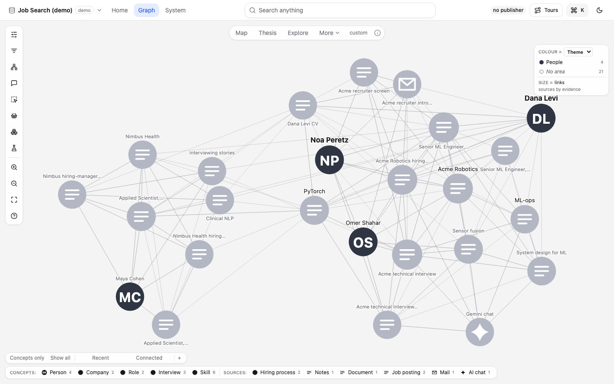
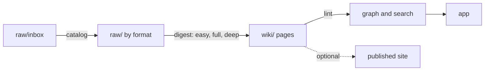

# kb-distillery

Supported platforms: macOS (Apple silicon and Intel) and Linux x86-64. Windows is not supported. Digests use Anthropic models only.

kb-distillery builds a knowledge base from sources you collect. You put papers, notes, web clips, mail and chats in a folder. An agent digests each source into a linked wiki page. A linter checks every page against a schema. An app shows the pages as a graph you can search and read. The knowledge stays in your own git repository, outside this one.



## Quick start

Supported platforms: macOS (Apple silicon and Intel) and Linux x86-64. Windows is not supported. Installing the wheel with pip needs Python 3.11 or newer (older Pythons fail with a confusing `grand-cypher` error). You need [pixi](https://pixi.sh) and git. Clone this repository and run:

```bash
git clone <repo-url> kb-distillery && cd kb-distillery
./install.sh
```

It installs pixi if needed, creates a default knowledge base and opens the app (Windows: use WSL2, see [Getting started](docs/getting-started.md)). To do it by hand, `pixi install`, `pixi run distill init` and `pixi run distill launch --kb <id>`; `distill init` asks for an id, a name and a kit. It creates `~/knowledge/<id>/` as a git repository and runs `distill doctor`. The first launch builds the app with Node (installed by pixi) and needs network access, which takes a few minutes. The app opens at `http://127.0.0.1:8765`.

Digests use Anthropic models only, through a Claude login or an Anthropic API key. Everything else works without one. See [Getting started](docs/getting-started.md).

To skip the questions, for scripts and CI: `pixi run distill init --kit base ~/knowledge --yes` (the directory is the parent folder; add `--kb-id <id>` to name it, default `my-kb`). `launch --kb` takes that id, or a path.

Search is keyword-only until you add the optional search service: `pixi run qmd-install` (needs Node 22 or newer). Everything else works without it.

Terms used below:

- **Agent**: a Claude Code session (or similar) that follows the skills and rules in the knowledge base's `AGENTS.md`.
- **Kit**: the set of page types and relations a knowledge base follows ([Kit](docs/concepts/kit.md)).
- **Digest**: turning one source into a wiki page, in three tiers: easy, full or deep ([Digest tiers](docs/concepts/digest-tiers.md)).
- **Knowledge operation**: any change to the knowledge base (ingest, digest, edit, undo), recorded as one git commit ([Concepts](docs/index.md)).

To see the app first, open the sample knowledge base `examples/demo` (a made-up job search): `pixi run distill launch --kb examples/demo`. `distill` is the command; `kbd` is a deprecated alias of `distill`.

## How it works



- `raw/` holds your sources. Nothing edits them.
- `wiki/` holds the pages. The linter is the schema.
- Each knowledge operation is one git commit in the knowledge base, so every step has an undo.
- Every model call goes through one gateway with three billing backends: subscription, API and Batch API.

More: [Architecture](docs/architecture.md), [Concepts](docs/index.md).

## Kits

A kit (the older word was template) sets the page types and relations of a knowledge base. A knowledge base names a kit and may add to it.

| Kit | For |
|---|---|
| `base` | A small general knowledge base: articles, notes, documents, topics, ideas, questions, people. |
| `research` | Academic reading: papers, books, lectures and typed relations such as `extends` and `contradicts`. |

See [Kit](docs/concepts/kit.md) and [Write a kit](docs/guides/write-a-kit.md).

## Publishing

A knowledge base can be published as a static site. Publishing is a plugin. Cloudflare Workers is built in. The audit step lists what a public build would expose before anything is deployed.

```bash
pixi run distill share audit <ref> --kb <id>
```

See [Publishing](docs/concepts/publishing.md) and [Add a publisher](docs/guides/add-a-publisher.md).

## Documentation

- [Getting started](docs/getting-started.md)
- [CLI reference](docs/reference/cli.md)
- [kb.toml reference](docs/reference/kb-toml.md)
- [Roadmap](docs/public-roadmap.md)
- [Contributing](CONTRIBUTING.md): how to run the tests and the gates

## License

MIT. See [`LICENSE`](LICENSE).
