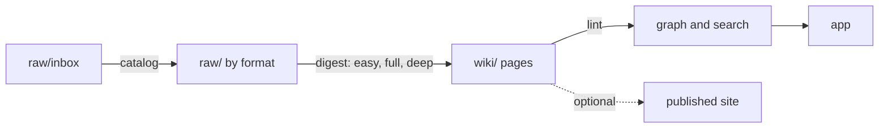

# kb-distillery

kb-distillery builds a knowledge base from sources you collect. You put papers, notes, web clips, mail and chats in a folder. An agent digests each source into a linked wiki page. A linter checks every page against a schema. An app shows the pages as a graph you can search and read. The knowledge stays in your own git repository, outside this one.

<!-- demo-kb screenshot: add docs/images/demo-graph.png (graph of examples/demo) and an image link here before release -->

## Quick start

Needs macOS, [pixi](https://pixi.sh) and git. Clone this repository and run:

```bash
pixi install
pixi run distill init
pixi run distill launch --kb <id>
```

`distill init` asks for an id, a name and a kit. It creates `~/knowledge/<id>/` as a git repository and runs `distill doctor`. The first launch builds the app, which takes a few minutes. The app opens at `http://127.0.0.1:8765`.

Digests need a Claude login or an API key. Everything else works without one. See [Getting started](docs/getting-started.md).

`examples/demo` is a sample knowledge base about a made-up job search. Open it with `pixi run distill launch --kb examples/demo`.

## How it works



- `raw/` holds your sources. Nothing edits them.
- `wiki/` holds the pages. The linter is the schema.
- Each knowledge operation is one git commit in the knowledge base, so every step has an undo.
- Every model call goes through one gateway with three billing backends: subscription, API and Batch API.

More: [Architecture](docs/architecture.md), [Concepts](docs/index.md).

## Kits

A kit sets the page types and relations of a knowledge base. A knowledge base names a kit and may add to it.

| Kit | For |
|---|---|
| `base` | A small general knowledge base: articles, notes, documents, topics, ideas, questions, people. |
| `research` | Academic reading: papers, books, lectures and typed relations such as `extends` and `contradicts`. |

See [Kit](docs/concepts/kit.md) and [Write a kit](docs/guides/write-a-kit.md).

## Publishing

A knowledge base can be published as a static site. Publishing is a plugin. Cloudflare Workers is built in. The audit step lists what a public build would expose before anything is deployed.

```bash
pixi run distill share audit <ref> --kb <id>
```

See [Publishing](docs/concepts/publishing.md) and [Add a publisher](docs/guides/add-a-publisher.md).

## Documentation

- [Getting started](docs/getting-started.md)
- [CLI reference](docs/reference/cli.md)
- [kb.toml reference](docs/reference/kb-toml.md)
- [Roadmap](docs/roadmap.md)
- [Contributing](.github/CONTRIBUTING.md)

## License

MIT. See [`LICENSE`](LICENSE).
