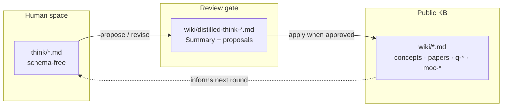
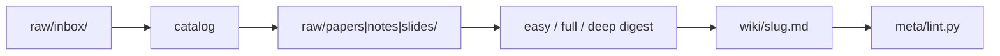

# yonatan-thesis-kb

Personal Obsidian knowledge base for exploring MSc thesis directions at RUNI (theoretical ML). The thesis topic is **not yet chosen** — the vault exists to read, think, connect, and decide.

Inspired by the [Karpathy LLM Wiki](https://gist.github.com/karpathy/442a6bf555914893e9891c11519de94f) pattern: a flat, cross-linked graph of notes that agents can query and extend — with one deliberate addition described below.

## Layers

| Layer | Path | Who owns it | Rule |
|-------|------|-------------|------|
| **Raw** | `raw/` | You | Immutable inputs — PDFs, slides, handwritten notes. Agents never write here. |
| **Wiki** | `wiki/` | Agents (+ you via Obsidian) | Public knowledge graph — concepts, papers, questions, MOCs. Schema-enforced. |
| **Think** | `think/` | **You only** | Slow, schema-free deliberation. Messy, personal, advisor notes, gut feelings. |
| **Meta** | `meta/` | Tooling | Linter, ingest/distill pipelines, skills, generated manifests. |

The wiki is the **published** graph. Think is the **private workshop**. That split is the main design choice in this vault.

## The innovation: think → periodic distillation → wiki

Most wikis mix rough notes and polished synthesis in one folder. Here they are separated on purpose:

1. **You write freely in `think/`** — no frontmatter rules, no section templates, no agent edits. Guardrails block agents from touching it.
2. **When ready, you distill** — an agent reads `think/`, produces a transient review page (`wiki/distilled-think-*.md`) with a prose **Summary** and a **Proposed propagation** table (which MOCs, questions, and concepts should change).
3. **You review** — edit the Summary, accept or reject individual proposals. Nothing public changes until you say so.
4. **You propagate** (`apply`) — approved edits land in the public wiki (thread bullets on MOCs, `Current state` on questions, `related:` on concepts). Lint runs; failures roll back.
5. **Repeat periodically** — think accumulates between distill passes. The KB advances in deliberate batches, not continuous agent churn.

Personal deliberation stays human-owned; the graph stays clean and citable. Exploration compounds instead of dying in a scratch file or a chat transcript.



**Distill commands:**

```bash
python3 -m meta.distill propose <think-file>     # read think/, write review page + plan
python3 -m meta.distill revise <think-file>      # re-read think/, keep your edited Summary
python3 -m meta.distill apply <think-file> --cleanup   # propagate + delete review page
```

Skill: `meta/skills/distill-think/SKILL.md` (synced to `.cursor/skills/`).

## The paper cycle (raw → wiki)

Parallel track for external sources — papers, slides, course notes:



| Step | What happens |
|------|----------------|
| **Scrap** | URL or file → `raw/inbox/` (dedup via `resolve` first) |
| **Catalog** | Inbox → typed `raw/` path + wiki stub |
| **Digest** | Agent writes paper note (`easy` skim · `full` standard · `deep` thesis-critical) |
| **Lint** | Regenerates `index.md`, `meta/corpus.tsv`; blocks illegal writes |

`meta/corpus.tsv` tracks every raw file — nothing is silently forgotten. Re-annotating a digested PDF on the tablet re-queues it automatically.

## Query and maintenance

- **Query the vault:** `python3 meta/query.py candidates "<keywords>"` → read pages → answer with `[[wikilinks]]` (`query-kb` skill).
- **Theme health:** `python3 meta/coherence.py status`, `python3 meta/semfind.py moc moc-info-theory`.
- **Share with another LLM:** `python3 meta/export.py` → `.exported/yonatan-thesis-kb-<timestamp>.zip`.

## Environment

One-time: `curl -fsSL https://pixi.sh/install.sh | bash`, then restart the shell.

```bash
pixi run lint          # schema check + regenerate index
pixi run health        # vault summary
pixi run dashboard     # http://127.0.0.1:8765
pixi run export-kb     # LLM share bundle
```

Without pixi: `python3 meta/lint.py`, `python3 -m meta.dashboard`, etc.

## For agents

Full schema, skill ladder, and write guardrails: **`AGENTS.md`**.  
Skills (canonical): `meta/skills/README.md` · sync: `pixi run sync-skills`.
