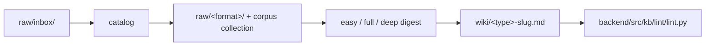

# yonatan-thesis-kb

Personal Obsidian knowledge base for exploring MSc thesis directions at RUNI (theoretical ML). The thesis topic is **not yet chosen** — the vault exists to read, think, connect, and decide.

Inspired by the [Karpathy LLM Wiki](https://gist.github.com/karpathy/442a6bf555914893e9891c11519de94f) pattern: a flat, cross-linked graph of notes that agents can query and extend — with one deliberate addition described below.

## Get started

`pixi run launch` opens the dashboard; its **Start** tab (`/start`) is the guide:

- **Edit knowledge** — say a trigger phrase to the agent (`scrap <url>`, `catalog`, `full-digest <raw>`, `split <idea>`, `distill think <file>`, `undo <step>`, `snapshot "week 43"` …). Each operation lands on main as one commit `kb(<op>): … (kb-x.y.z)`; your `think/` edits are committed as `kb(think)`.
- **Develop a feature** — `pixi run ship -- start <feature> --worktree` → `ship -- commit "feat(<component>): add …"` → `ship -- pr` → approve → `ship -- merge` (skill `infra-pr`). Tooling never commits to main directly.
- **Go deeper** — the **Lifecycle** tab (versions, history, snapshots, guardrails), `AGENTS.md` (+ its doc router into `meta-defaults/docs/`), `skills/README.md`.

## Layers

| Layer | Path | Who owns it | Rule |
|-------|------|-------------|------|
| **Raw** | `raw/` | You | Immutable inputs, split by format: `printed-docs/ handwritten/ presentations/ llm-chats/ emails/ web-clips/ images/` + `inbox/`. Agents never write here. |
| **Wiki** | `wiki/` | Agents (+ you via Obsidian) | Public knowledge graph in three page layers: **sources** (`paper-` `lecture-` …, one per raw item, at a reading `depth`), **collections** (`book-` `course-` …, tables of sources), **concepts** (ideas, topics `theme-`, questions `q-`, people). Schema-enforced. |
| **Think** | `think/` | **You only** | Slow, schema-free deliberation. Messy, personal, advisor notes, gut feelings. |
| **Meta** | `meta/` | Tooling | Linter, ingest/distill pipelines, skills, generated manifests. |

The wiki is the **published** graph. Think is the **private workshop**. That split is the main design choice in this vault.

## The innovation: think → periodic distillation → wiki

Most wikis mix rough notes and polished synthesis in one folder. Here they are separated on purpose:

1. **You write freely in `think/`** — no frontmatter rules, no section templates, no agent edits. Guardrails block agents from touching it.
2. **When ready, you distill** — an agent reads `think/`, produces a transient review page (`wiki/distilled-think-*.md`) with a prose **Summary** and a **Proposed propagation** table (which topics, questions, and ideas should change).
3. **You review** — edit the Summary, accept or reject individual proposals. Nothing public changes until you say so.
4. **You propagate** (`apply`) — approved edits land in the public wiki (thread bullets on topic pages, `Current state` on questions, `related:` on ideas). Lint runs; failures roll back.
5. **Repeat periodically** — think accumulates between distill passes. The KB advances in deliberate batches, not continuous agent churn.

Personal deliberation stays human-owned; the graph stays clean and citable. Exploration compounds instead of dying in a scratch file or a chat transcript.


**Distill commands:**

```bash
python3 -m kb.distill propose <think-file>     # read think/, write review page + plan
python3 -m kb.distill revise <think-file>      # re-read think/, keep your edited Summary
python3 -m kb.distill apply <think-file> --cleanup   # propagate + delete review page
```

Skill: `skills/distill-think/SKILL.md` (`.claude/skills`, `.cursor/skills` are symlinks to `skills/`).

## The source cycle (raw → wiki)

Parallel track for external sources — papers, slides, course notes:



| Step | What happens |
|------|----------------|
| **Add** (scrap) | URL or file → `raw/inbox/` (dedup via `resolve` first) |
| **Catalog** | Inbox → `raw/<format>/` (flat; never moves again) + corpus row with its `collection` (course/series/book collection or researcher); papers also get a `paper-` Source page at `depth: listed` |
| **Digest** | Agent deepens the Source page in place (`depth`: `easy` skim · `full` full note · `deep` thesis-critical) — a paper, a book part, or a course/series row (`--row N` → `lecture-`/`article-`/`mail-`/`paper-`) |
| **Lint** | Regenerates `index.md`, `meta/corpus.tsv`; blocks illegal writes |

`meta/corpus.tsv` tracks every raw file — nothing is silently forgotten. Re-annotating a cited PDF (disposition `source`) on the tablet re-queues it automatically.

## Query and maintenance

- **Query the vault:** `python3 -m kb.search.query candidates "<keywords>"` → read pages → answer with `[[wikilinks]]` (`query-kb` skill).
- **Topic health:** `python3 -m kb.core.coherence status`, `python3 -m kb.search.semfind topic theme-info-theory`.
- **Share with another LLM:** `python3 -m kb.maintenance.export` → `.exported/yonatan-thesis-kb-<timestamp>.zip`.

## Environment

One-time: `curl -fsSL https://pixi.sh/install.sh | bash`, then restart the shell.

```bash
pixi run lint          # schema check + regenerate index
pixi run health        # vault summary
pixi run dashboard     # http://127.0.0.1:8765 (Start tab: /start)
pixi run ops -- status # knowledge version, sessions, hooks
pixi run export-kb     # LLM share bundle
```

Without pixi: `python3 -m kb.lint.lint`, `python3 -m kb.dashboard`, etc.

## For agents

Core rules and the doc router: **`AGENTS.md`**; schema, skill ladder and write guardrails in `meta-defaults/docs/`.  
Skills (canonical): `skills/README.md` · sync: `pixi run sync-skills`.
